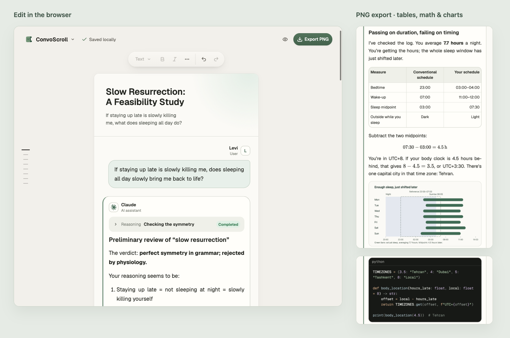

<p align="center">
  
</p>

<h1 align="center">ConvoScroll</h1>

<p align="center">Turn AI conversations worth keeping into readable, shareable scrolls</p>

<p align="center">
  <a href="https://convoscroll.lexencole.com"><strong>Open ConvoScroll</strong></a> ·
  <a href="docs/USAGE.en.md">User guide</a> ·
  <a href="skills/convoscroll/">Agent Skill</a>
</p>

<p align="center"><a href="README.md">简体中文</a> · English</p>



<p align="center">
  Web editor and PNG output · View full examples:
  <a href="docs/images/example-short-en.png">Short Q&amp;A</a> ·
  <a href="docs/images/example-story-en.png">Long conversation</a>
</p>

ConvoScroll is an open-source tool for turning AI conversations into images. Edit in the browser, or ask your own AI agent to prepare the content, then export a crisp PNG. No account required. Editing and export run in your browser.

## From conversation to image

- **Keep rich content.** Markdown, syntax-highlighted code, LaTeX equations, tables, images, files, and collapsible reasoning or tool records.
- **Edit directly.** Click text to change it. Set names, models, and avatars, move or copy messages, and undo changes.
- **Make it shareable.** Choose the canvas width and resolution. Split long conversations at content boundaries, with the same layout in preview and export.
- **Keep an editable copy.** Drafts save in the current browser. Export a `.convcanvas` file to take the conversation and its attachments with you.

## Get started

1. **Add your content** — [Open ConvoScroll](https://convoscroll.lexencole.com) and start with a built-in sample, or use the top-left **Document** menu to create a conversation or import `.md` / `.convcanvas`.
2. **Make it yours** — Click text to edit or an avatar to change the speaker. Type `/` in an empty paragraph to add code, equations, tables, or images.
3. **Export an image** — Check the result with **Preview**, then choose **Export PNG**. Adjust width and resolution in **Document → Export settings**.

Choose **Document → Export project** to keep an editable copy. See the [user guide](docs/USAGE.en.md) for more.

## Ask an AI agent to create the image

Add the complete [convoscroll Skill directory](skills/convoscroll/) to a client that supports Agent Skills, then provide selected chat messages, text, or screenshots:

> Turn this conversation into a ConvoScroll image. Keep the original wording and give me the PNG and editable project file.

The agent prepares the content, opens ConvoScroll, imports and checks it, then exports the image. Use an agent with browser and file capabilities. See the [Skill instructions](skills/convoscroll/SKILL.md) for requirements.

## Privacy and storage

ConvoScroll processes conversations and attachments in the browser without uploading them to its servers. When you use an agent, your chosen AI service handles the content.

Drafts stay in the current browser. Export a `.convcanvas` project to back up your work or move between devices. See [storage and privacy](docs/USAGE.en.md#storage-and-privacy) for details.

## Run locally

Use Node.js 22.13 or later and npm. Download or clone the repository, then run in its directory:

```bash
npm ci
npm run dev
```

Open the local address printed in the terminal. The [development guide](docs/DEVELOPMENT.md) covers builds, tests, self-hosting, and optional offline command-line rendering. For format integrations, see the [project and Markdown format](docs/PROJECT_FORMAT.md) and [schema](docs/SCHEMA.md). Technical references are currently in Chinese.

See the [contributing guide](CONTRIBUTING.en.md) for bug reports and code changes.

## Roadmap

- More conversation backgrounds and themes, with customization.
- A standalone application.

## License

Source code is available under the [MIT License](LICENSE). See [third-party notices](public/THIRD_PARTY_NOTICES.txt) for font, icon, and dependency licenses and attribution.
