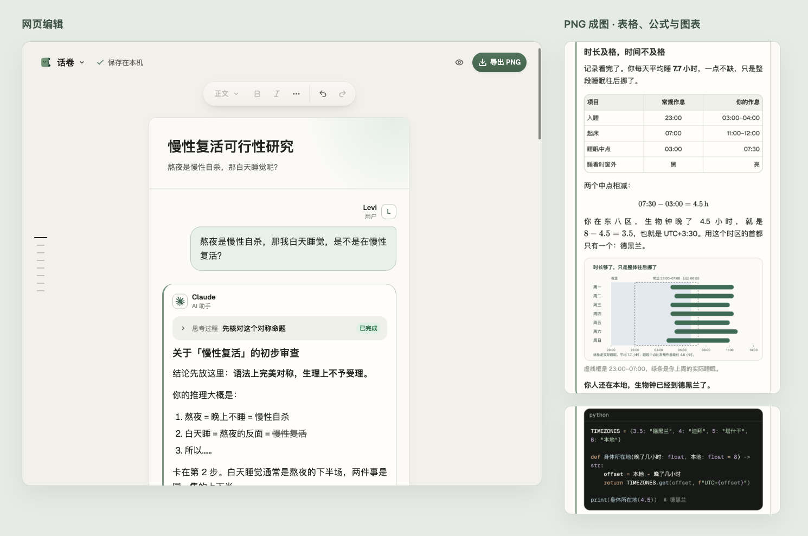

<p align="center">
  
</p>

<h1 align="center">话卷 ConvoScroll</h1>

<p align="center">把值得留下的 AI 对话，做成适合阅读和分享的长图</p>

<p align="center">
  <a href="https://convoscroll.lexencole.com"><strong>打开话卷</strong></a> ·
  <a href="docs/USAGE.md">使用指南</a> ·
  <a href="skills/convoscroll/">Agent Skill</a>
</p>

<p align="center">简体中文 · <a href="README.en.md">English</a></p>



<p align="center">
  网页编辑与 PNG 成图 · 查看完整示例：
  <a href="docs/images/example-short-zh.png">简短问答</a> ·
  <a href="docs/images/example-story-zh.png">长对话</a>
</p>

话卷是一款开源的 AI 对话排版工具。直接在网页上编辑，或让自己的 AI Agent 整理聊天内容，再导出清晰的 PNG。无需注册，编辑与出图都在浏览器中完成。

## 从对话到成图

- **内容完整**：Markdown、代码高亮、LaTeX 公式、表格、图片和文件，以及可折叠的思考过程与工具记录。
- **直接编辑**：点击文字即可修改；调整名字、模型与头像，移动或复制消息，随时撤销。
- **适合分享**：选择画布宽度和清晰度，长对话按内容分段，导出与预览使用相同的排版。
- **可以接着改**：草稿自动保存在当前浏览器；导出 `.convcanvas`，将对话与附件一起带走。

## 开始使用

1. **准备内容** — [打开话卷](https://convoscroll.lexencole.com)，从内置示例开始，或在左上角“文档”菜单中新建、导入 `.md` / `.convcanvas`。
2. **调整排版** — 点击正文编辑，点击头像修改身份。在空白段落输入 `/`，添加代码、公式、表格或图片。
3. **导出长图** — 点击“预览”查看效果，再点“导出 PNG”。宽度和清晰度在“文档 → 导出设置”中调整。

要保留可编辑版本，选择“文档 → 导出项目”。更多操作见[使用指南](docs/USAGE.md)。

## 让 AI Agent 帮你出图

把 [convoscroll Skill](skills/convoscroll/) 的完整目录添加到支持 Agent Skills 的客户端，然后提供选定的聊天、文字或截图：

> 把这段对话用话卷做成长图，保留原文，给我 PNG 和可编辑的项目文件。

Agent 会整理内容，打开话卷导入、校对并出图。请使用支持浏览器操作和文件处理的 Agent，具体要求见 [Skill 说明](skills/convoscroll/SKILL.md)。

## 隐私与保存

话卷在浏览器中处理对话和附件，不会上传到话卷服务器。使用 Agent 时，内容由你选择的 AI 服务处理。

草稿保存在当前浏览器。备份或换设备时，请导出 `.convcanvas` 项目。详见[保存与隐私说明](docs/USAGE.md#保存与隐私)。

## 本地运行

需要 Node.js 22.13 以上和 npm。下载或克隆仓库后，在项目目录运行：

```bash
npm ci
npm run dev
```

打开终端显示的本机地址。构建、测试、自部署和可选的离线命令行出图见[开发说明](docs/DEVELOPMENT.md)；格式集成见[项目与 Markdown 格式](docs/PROJECT_FORMAT.md)和 [Schema](docs/SCHEMA.md)。

反馈问题或参与开发见[贡献指南](CONTRIBUTING.md)。

## 后续方向

- 支持更多聊天背景与主题样式，并允许自定义。
- 打包成独立程序。

## 许可证

源码采用 [MIT License](LICENSE)。字体、图标和依赖的许可与署名见[第三方许可清单](public/THIRD_PARTY_NOTICES.txt)。
